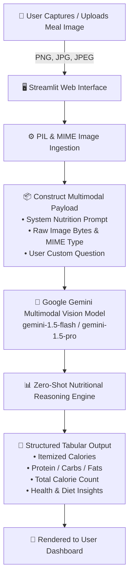

# 🥗 AI Health & Nutrition Analyser (Gemini Multimodal Vision)

[](https://www.python.org/)
[](https://streamlit.io/)
[](https://ai.google.dev/)
[]()
[]()
[]()

> An intelligent, AI-driven dietary intelligence web application that visually detects food items from meal photos, calculates total caloric intake, estimates macronutrients (protein, carbs, and fats), and provides expert nutritional advice using Google's **Gemini Multimodal Vision AI**.

---

## 📌 Executive Overview

Maintaining a balanced diet and tracking daily nutritional intake are cornerstones of preventative healthcare and fitness. However, conventional dietary tracking is notoriously tedious: users must manually look up ingredient names, weigh portions on digital scales, and search across disparate nutrition databases.

**AI Health & Nutrition Analyser** eliminates this friction by leveraging state-of-the-art **Multimodal Large Language Models (LLMs)**. Simply upload or snap a photo of any meal (breakfast plate, home-cooked curry, restaurant dish, snack, or beverage), and the system autonomously:
1. Identifies every discrete food component on the plate.
2. Estimates caloric values for each identified item and calculates aggregate meal calories.
3. Quantifies key macronutrients—**Protein**, **Carbohydrates**, and **Fats**—in a clean, structured table.
4. Answers customized dietary queries (e.g., *"Is this safe for a type-2 diabetic?"*, *"How can I increase the protein in this dish?"*).

---

## 🏗️ System Architecture & Workflow

The application combines a high-performance **Streamlit** reactive frontend with **Google Gemini's Multimodal Vision API** to provide near-instantaneous dietary analysis:



---

## ✨ Key Features

- **👁️ Zero-Shot Food Recognition**: Detects multiple food items, condiments, and side dishes within complex, heterogeneous plates without requiring domain-specific training sets.
- **🔥 Automated Calorie Calculation**: Generates itemized calorie estimates alongside a summary of total meal energy expenditure.
- **🥑 Macronutrient Profiling**: Formats key macros (**Protein**, **Carbohydrates**, and **Fats**) into an easy-to-read comparative table.
- **💬 Natural Language Querying**: Enter custom questions alongside meal photos to assess fitness goals, allergen warnings, or dietary compatibility (e.g., Keto, Vegan, Diabetic, Low-FODMAP).
- **⚡ High-Throughput & Low Latency**: Powered by **Gemini 1.5 Flash**, offering lightning-fast inference times ideal for consumer-facing mobile and web applications.
- **🔒 Secure Configuration**: Environment variable isolation ensures your Google AI Studio API credentials stay private and protected.

---

## 🛠️ Technology Stack

| Component | Technology | Role & Purpose |
| :--- | :--- | :--- |
| **User Interface** | [Streamlit](https://streamlit.io/) | Reactive web application, file uploader, and dynamic dashboard rendering |
| **Vision-Language Model** | [Google Gemini](https://ai.google.dev/) (`gemini-1.5-flash` / `gemini-1.5-pro`) | Multimodal image understanding, food identification, and nutritional reasoning |
| **Image Processing** | [Pillow (PIL)](https://python-pillow.org/) | Ingestion, format inspection, and inline image conversion |
| **Environment Management** | [python-dotenv](https://github.com/theskumar/python-dotenv) | Secure API key management via `.env` configuration |
| **RAG & Vector Extensions** | `langchain`, `PyPDF2`, `chromadb`, `faiss-cpu` | Scalable foundation for meal logging history, diet charts, and vector search |

---

## 📁 Repository Structure

```plaintext
Health-and-Nutrition-Analyser/
│
├── app.py                  # Main Streamlit web application & Gemini API integration
├── requirements.txt        # Python package dependencies
├── .env.example            # Environment configuration template
├── .gitignore              # Ignores sensitive keys, venv, and cache files
└── README.md               # Comprehensive project documentation
```

---

## 🚀 Getting Started

Follow these step-by-step instructions to set up and run the application locally on your machine.

### 1. Prerequisites

- **Python 3.9 or higher** installed ([Download Python](https://www.python.org/downloads/)).
- A **Google Gemini API Key** (obtain a free key from [Google AI Studio](https://aistudio.google.com/app/apikey)).

### 2. Clone or Navigate to the Repository

```bash
git clone https://github.com/your-username/Health-and-Nutrition-Analyser.git
cd Health-and-Nutrition-Analyser
```

### 3. Create & Activate a Virtual Environment

It is recommended to use a virtual environment to isolate project dependencies:

- **Windows (PowerShell / Command Prompt)**:
  ```powershell
  python -m venv venv
  venv\Scripts\activate
  ```

- **macOS / Linux**:
  ```bash
  python3 -m venv venv
  source venv/bin/activate
  ```

### 4. Install Dependencies

Install all required packages from `requirements.txt`:

```bash
pip install -r requirements.txt
```

### 5. Configure Your API Key

1. Copy the example environment file:
   ```bash
   cp .env.example .env     # macOS / Linux
   copy .env.example .env   # Windows
   ```
2. Open `.env` in any text editor and insert your Google Gemini API key:
   ```env
   GOOGLE_API_KEY=your_actual_gemini_api_key_here
   ```

### 6. Launch the Application

Start the Streamlit development server:

```bash
streamlit run app.py
```

Your browser will automatically open the application at:
```text
http://localhost:8501
```

---

## 💡 How to Use the App

1. **Upload an Image**: Click **"Choose an image..."** to upload a photo of your meal (`.jpg`, `.jpeg`, or `.png`).
2. **(Optional) Enter Custom Prompt**: Type specific dietary queries into the prompt box (e.g., *"Evaluate this for high blood pressure"* or *"Suggest healthier substitutions"*).
3. **Click "CHECK"**: The system processes the image through Google Gemini Vision and generates your nutritional assessment.
4. **Review Results**: View the itemized breakdown, total calories, macronutrient table, and personalized health recommendations.

---

## 🧪 Sample Prompts & Use Cases

| Goal | Sample User Input Prompt |
| :--- | :--- |
| **Standard Calorie Breakdown** | *(Default prompt automatically extracts calories & macros)* |
| **Keto / Low-Carb Check** | *"Is this meal keto-friendly? Calculate the net carb content."* |
| **Muscle Building / Fitness** | *"Does this meal hit at least 35g of protein? How can I boost protein density?"* |
| **Diabetic Evaluation** | *"Evaluate glycemic impact and identify high glycemic index carbohydrates."* |
| **Healthy Swaps** | *"Suggest 2 healthier ingredient alternatives to reduce total saturated fat."* |
| **Allergy & Intolerance Alert** | *"Flag any potential common allergens present in this meal (dairy, nuts, gluten)."* |

---

## 📊 Sample Output Preview

```markdown
### 🥗 Nutritional Breakdown

| Food Item | Estimated Portion | Calories (kcal) | Protein (g) | Carbohydrates (g) | Fats (g) |
| :--- | :--- | :--- | :--- | :--- | :--- |
| Grilled Chicken Breast | 150g | 247 | 46.5 | 0.0 | 5.4 |
| Brown Rice | 1 cup (195g) | 218 | 4.5 | 45.8 | 1.6 |
| Steamed Broccoli | 1 cup (91g) | 31 | 2.6 | 6.0 | 0.3 |
| Extra Virgin Olive Oil | 1 tsp (5ml) | 40 | 0.0 | 0.0 | 4.5 |
| **TOTAL** | — | **536 kcal** | **53.6 g** | **51.8 g** | **11.8 g** |

**💡 Dietary Assessment**:
- **Macronutrient Ratio**: Balanced high-protein, moderate-carbohydrate profile ideal for athletic recovery.
- **Micronutrient Highlights**: Rich in Vitamin C and Sulforaphane (from broccoli), B-complex vitamins, and magnesium.
```

---

## 🔮 Future Roadmap & Enhancements

- [ ] **Multi-Page PDF Diet Plan Ingestion**: Integrate `PyPDF2` and `langchain` to extract and audit multi-day nutrition plans.
- [ ] **RAG-Powered USDA Database Verification**: Embed USDA FoodData Central via `chromadb` / `faiss-cpu` for validated ground-truth portion lookup.
- [ ] **Barcode & Nutrition Label Scanner**: Real-time camera integration for packaged food items and ingredients.
- [ ] **Direct Export**: Download meal analysis as CSV, Excel, or PDF health reports.
- [ ] **Mobile Optimization**: PWA (Progressive Web App) deployment for instant on-the-go meal scanning.

---

## 📄 License

Distributed under the **MIT License**. See `LICENSE` for more information.

---

## 🤝 Contributing & Acknowledgments

Contributions, issues, and feature requests are welcome!
- Built with [Google Gemini API](https://ai.google.dev/)
- Interface crafted with [Streamlit](https://streamlit.io/)
